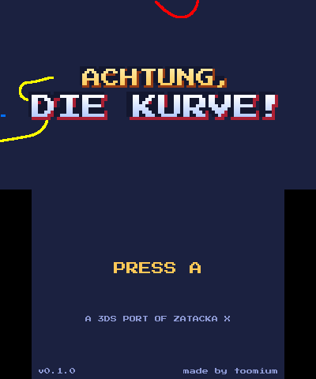
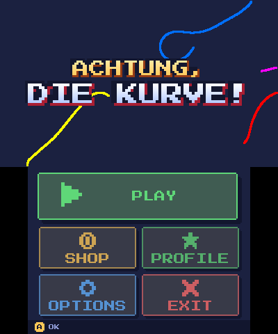
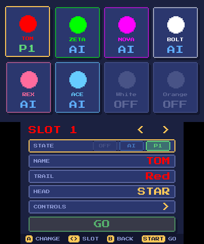
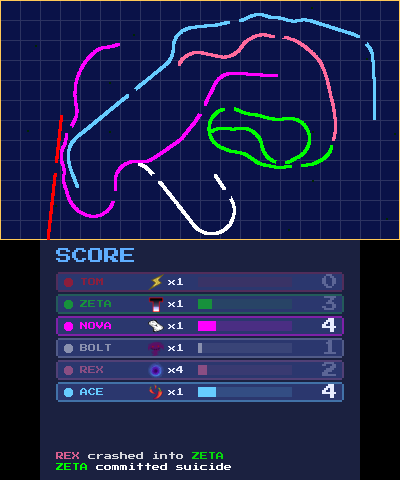
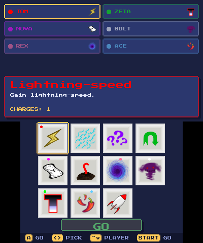
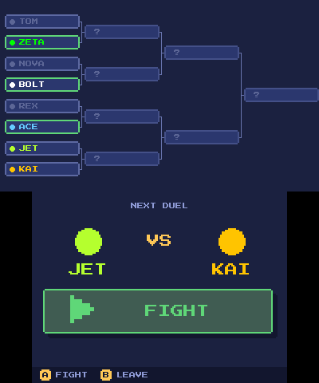
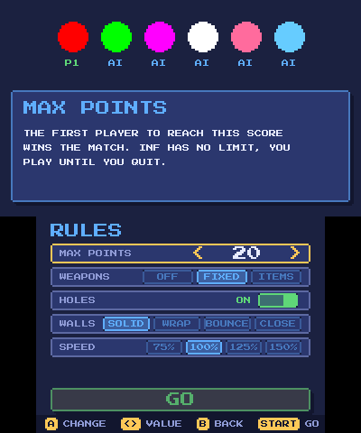
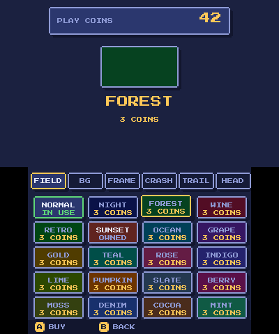
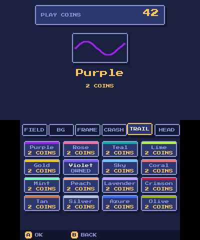
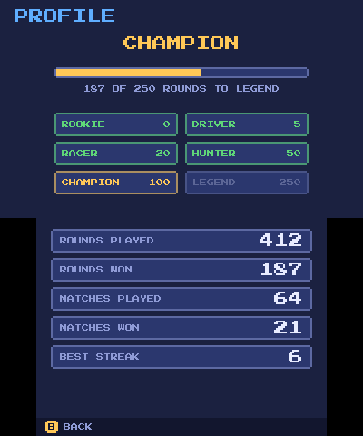

# Achtung, die Kurve!

**A Nintendo 3DS port of [Zatacka X](https://github.com/simenheg/zatackax), the free remake of the classic curve-fighting game.**

Steer a line that never stops growing. Don't touch a wall, don't touch another line, don't touch
your own. The last one alive scores. Up to three people share one console, and computer players fill the
rest, up to eight in all. With several consoles, over Local Play, eight people can play at once. Weapons, computer opponents, a tournament and a shop for
cosmetics (paid with the Play Coins you walk for) are on top.

| | | |
|:--:|:--:|:--:|
|  Menu |  Eight places |  A round |
|  Weapons |  Tournament |  Rules |
|  Shop |  Trail colors |  Profile and titles |

## Install on a 3DS

You need a 3DS with custom firmware.

**The easy way: scan the code.** Open [FBI](https://github.com/Steveice10/FBI), choose
*Remote Install*, then *Scan QR Code*, and scan this. It always leads to the newest release.

**Other ways**, from the [releases page](https://github.com/toomium/Achtung-die-Kurve-3DS/releases/latest):

- `achtung-die-kurve.cia`: copy it to the SD card and install it with FBI.
- `achtung-die-kurve.3dsx`: copy it to `sd:/3ds/` and start it from the Homebrew Launcher. No
  installation needed.

Sound needs the DSP firmware dumped from your own console (`sd:/3ds/dspfirm.cdc`). Without it
the game runs, but silent. Settings and what you have bought are saved in
`sd:/3ds/zatackax/settings.cfg`.

## Features

**The game**
- Eight places on one console: up to three people (each with their own buttons) and computer
  players in three skill levels. Everyone has their own trail color and head marker.
- Local Play with several consoles: up to eight players in all, computer players included.
- Knock-out tournament for three to eight players, with a bracket.
- Weapons: off, chosen before the game, or collected as items on the field.
- Rules: points to win, holes in the lines, speed, and four kinds of walls: solid, wrapping,
  bouncing, or closing in after ten seconds.
- A profile with the rounds and matches you won, and titles that go with them.

**Made for the 3DS**
- Touch menus on the bottom screen, a pixel-font interface on both screens, the playfield on
  the top screen.
- Play Coins shop: playfield colors and patterns, frames, crash effects, 16 more trail colors
  and head markers. It only changes how the game looks, never how it plays.
- It uses the real Play Coins of the console, no coins of its own.

## Building

### Nintendo 3DS

You need [devkitPro](https://devkitpro.org/) with devkitARM and libctru, and the SDL 1.2 portlibs:

    sudo dkp-pacman -S 3ds-dev 3ds-sdl 3ds-sdl_image 3ds-sdl_mixer 3ds-sdl_ttf

`ffmpeg` is optional: it converts the sounds to a lighter format, which the 3DS plays more smoothly.

    export DEVKITPRO=/opt/devkitpro
    export DEVKITARM=$DEVKITPRO/devkitARM
    export PORTLIBS=$DEVKITPRO/portlibs/3ds
    cd 3ds
    make

This makes `3ds/zatackax.3dsx`. Run it on a console, or in an emulator such as
[Azahar](https://azahar-emu.org/). The CIA of a release is made by the GitHub workflow in
`.github/workflows/release.yml`; `3ds/tools/make-cia.sh` does the same on your machine if you
have `makerom` and `bannertool`.

More on the port is in [3ds/README.md](3ds/README.md).

### Linux and other desktops

The desktop version of Zatacka X is still built from the same source, and it plays as before.

    ./configure
    make devel          # runs from this directory
    ./zatackax

or `make && sudo make install` to install it. You need SDL 1.2, SDL_image, SDL_ttf and SDL_mixer.
On Debian:

    sudo apt install libsdl1.2-dev libsdl-image1.2-dev libsdl-ttf2.0-dev libsdl-mixer1.2-dev

### Tests

    make -C tests

builds and runs small tests of the settings file, the computer players, the items, the tournament
bracket and the statistics. They only need the SDL 1.2 headers.

## License

- **Code:** GNU General Public License version 3 or later, see [COPYING](COPYING). The 3DS port
  is a modification of Zatacka X and keeps that license.
- **Graphics and sound** of the game: Creative Commons Attribution-ShareAlike (CC BY-SA), unless
  [AUTHORS](AUTHORS.md) says otherwise. The logo, banner and icon of the 3DS version
  (made by `3ds/tools/make-logo.py`) are under the same license.
- **Fonts:** Press Start 2P (the 3DS interface, [OFL](3ds/assets/fonts/OFL.txt)), Anka/Coder and
  Jura (the desktop version), all under the SIL Open Font License.

Contributions are accepted under the same terms.

### Credits

Zatacka X is written by Simen Heggestøyl and others, see [AUTHORS](AUTHORS.md). The 3DS port is
by [toomium](https://github.com/toomium). The idea comes from the game *Achtung, die Kurve!*
(also known as *Zatacka*); Zatacka X and this port are independent remakes.

### Notices

- This is a fan project. It is not made, endorsed or supported by Nintendo or by the makers
  of the original game. *Nintendo 3DS* and *Play Coins* are trademarks of Nintendo; *Achtung, die
  Kurve!* is the name of the original game. They are used only to say what this software is for.
- It contains no Nintendo software and none of its files. The DSP firmware for sound is not
  included; you dump it from your own console.
- The game reads your Play Coins from the console, and it can spend them in the shop. You do that
  at your own risk. Installing homebrew can void your warranty.
- This software comes with no warranty, as far as the law allows (see GPL sections 15 and 16).

## Contact

Problems with the 3DS version: open an [issue](https://github.com/toomium/Achtung-die-Kurve-3DS/issues).
For Zatacka X itself, see [simenheg/zatackax](https://github.com/simenheg/zatackax).
